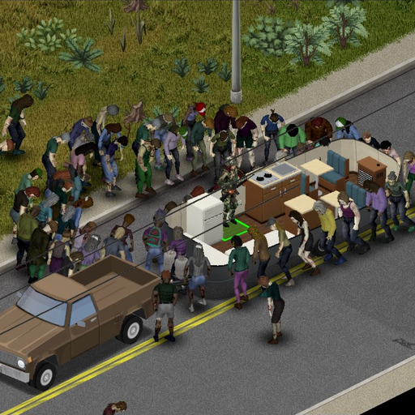

# Real Vehicle Interiors — Animals WIP

**Development branch: `codex/animals-support`.** Includes Claude's in-progress animal rendering, carry/drop/pickup, food/water and Companion Dogs integration. This is unreleased and not ready for ordinary saves. See [Animals status and remaining checks](docs/ANIMALS.md).

[](https://github.com/prg299/Real-Vehicle-Interiors/actions/workflows/checks.yml)
[](LICENSE)

Walk around inside KI5 campers, B700 buses and F700 box trucks in **Project Zomboid Build 42.21**. Furnish a camper, sleep, cook, wash, store supplies, place loose items and take your base with you. The roof and upper walls cut away while you are inside.

**Public beta: 2.0.8.** Multiplayer is supported with known limitations. Back up saves before changing mods. Animals support is work in progress on [`codex/animals-support`](https://github.com/prg299/Real-Vehicle-Interiors/tree/codex/animals-support); it remains excluded from `main` and the published mod.



## Play

Subscribe to [Real Vehicle Interiors on Steam Workshop](https://steamcommunity.com/sharedfiles/filedetails/?id=3811728541) and its required items:

| Dependency | Workshop item | Mod ID |
| --- | --- | --- |
| ZombieBuddy | [3619862853](https://steamcommunity.com/sharedfiles/filedetails/?id=3619862853) | `ZombieBuddy` |
| that DAMN Library | [3171167894](https://steamcommunity.com/sharedfiles/filedetails/?id=3171167894) | `damnlib` |
| Campers! (KI5) | [3670064951](https://steamcommunity.com/sharedfiles/filedetails/?id=3670064951) | `KI5campers` |
| '87 Ford B700/F700 Trucks (KI5) | [3110911330](https://steamcommunity.com/sharedfiles/filedetails/?id=3110911330) | `87fordB700` |

Enable the dependencies before `RealVehicleInteriors`. Install and approve the Java component through ZombieBuddy. In multiplayer, clients need the Java component; the 2.0.8 indoor panic adapter also needs it on the server. The other interior features retain their Lua support on servers without the Java component. Restart the server and clients after updates.

Supported interiors: Flying Cloud 22, Bambi 16, Shasta Airflyte/Astrodome, Scamp 13/16, B700 school/prison/military buses and the F700 box truck. Small KI5 cargo trailers are deliberately unsupported.

## Develop

Clone this repository, install **PowerShell 7, JDK 25, Python 3.10+**, Project Zomboid 42.21 and the dependencies above. Set the local paths, then build:

```powershell
$env:PZ_GAME_DIR = 'C:\SteamLibrary\steamapps\common\ProjectZomboid'
$env:PZ_WORKSHOP_DIR = 'C:\SteamLibrary\steamapps\workshop\content\108600'
$env:RVI_JAVA_HOME = 'C:\path\to\jdk-25'
pwsh -NoProfile -File scripts/build.ps1
pwsh -NoProfile -File scripts/check-release.ps1
```

On the maintainer's shared Windows machine, run every build, check and native session through `node C:/Users/erika/.codex/tools/run-heavy.mjs -- <program> <args>`; see [development setup](docs/DEVELOPMENT.md). The local guard is not a dependency for other contributors or hosted CI.

The build writes `build/rv/package/RealVehicleInteriors`. It compiles Java, checks Lua with the game's Kahlua compiler, validates translations, and reconstructs the cutaway shaders from the installed game's shaders. Game files and dependency downloads remain external inputs. No game or dependency binaries are included.

| Directory | Purpose |
| --- | --- |
| `mod/RealVehicleInteriors/` | Shipped Lua, animations, models, textures, translations and descriptors |
| `src/me/lens/rv/` | Java renderer and ZombieBuddy hooks; stable compatibility namespace |
| `scripts/` | Build, regression, isolated profile, install and Workshop tools |
| `tools-src/` | Compiler helpers, production-Lua regression fixtures, Blender generators and shader recipes |
| `dev/` | Isolated native input and multiplayer harnesses; never shipped |
| `assets/branding/` | Original promotional art master and generation provenance |
| `docs/` | Architecture, setup, compatibility, release baseline and known limitations |
| `release/workshop/` | Public Workshop identity, description, change notes and preview |

Start with [CONTRIBUTING.md](CONTRIBUTING.md), [architecture](docs/ARCHITECTURE.md), [development](docs/DEVELOPMENT.md), [compatibility and known issues](docs/COMPATIBILITY.md), and the [roadmap](docs/ROADMAP.md). Bug reports and pull requests are welcome, including vehicle compatibility add-ons.

## License and credits

Authored code, tools, documentation and project artwork are available under the [MIT license](LICENSE). See [third-party notices](THIRD_PARTY_NOTICES.md) for external game/dependency rights and locally reconstructed shaders. KI5's vehicles and damnlib remain external dependencies. AI tools were used for code and artwork; source prompts and masters are retained where available.
